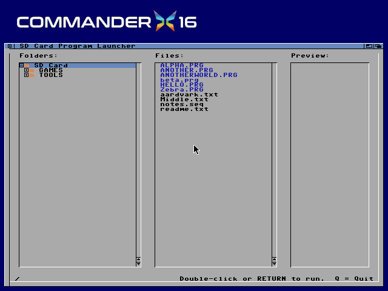

# GUIMenu_X16

A mouse-driven program launcher for the [Commander X16](https://www.commanderx16.com/), written in 6502 assembly.

Browse the folders on your SD card, see the files in each one, and double-click a `.PRG` to load and run it. It's styled after an Amiga Workbench 2.0/3.1 window.



## Features

- **Folder tree:** shows the folders on the SD card, each with an orange folder icon. Click a folder to open it. Click its `[+]`/`[-]` box to expand or collapse it.
- **File list:** shows the files in the open folder. Programs (`.PRG`) are listed first and shown in blue, followed by the other files in black. Each group is sorted alphabetically.
- **Double-click to run:** double-click a `.PRG` (or highlight it and press RETURN) to load and run it. The program starts in its own folder, so it can find its data files.
- **Keyboard navigation:** Up/Down move through a list, Left/Right go up and down the folder levels, and Tab switches lists. See [Controls](#controls).
- **Scroll bars:** Amiga style, with both arrows at the bottom. Click the arrows to scroll a line (hold to repeat), click the track to scroll a page, or drag the thumb. The mouse wheel scrolls the list under the pointer.
- **Amiga Workbench look:** a grey window with raised 3D edges and a blue title bar, sunken list boxes and a status line, on a dark blue desktop. The close, zoom and depth gadgets are decoration only.
- **Status line:** shows the path of the open folder, e.g. `/GAMES/ARCADE`.
- **Desktop logo:** the Commander X16 logo picture at the top left, drawn with five 64x64 hardware sprites.
- **Preview panel:** reserved for showing an image of the selected program (not implemented yet).

## Requirements

- A Commander X16 or the [x16emu](https://github.com/X16Community/x16-emulator) emulator. Developed and tested on ROM R49.
- [cc65](https://cc65.github.io/) to build it (`cl65` must be on your `PATH`).

## Building

```sh
make
```

This runs:

```sh
cl65 -t cx16 -C cx16-asm.cfg -u __EXEHDR__ -o GUIMENU.PRG -l GUIMENU.LIST -Ln GUIMENU.SYM GUIMENU.ASM
```

`-u __EXEHDR__` adds a `10 SYS 2061` BASIC line to the start of the program so it can be started with `RUN`. `make clean` removes the build output.

A pre-built `GUIMENU.PRG` is included in the repository.

## Running

Copy `GUIMENU.PRG` to your SD card, then type:

```
LOAD "GUIMENU.PRG"
RUN
```

In the emulator you can use an SD card image:

```sh
x16emu -sdcard sdcard.img -prg GUIMENU.PRG -run
```

If you leave out `-sdcard`, the emulator uses the host file system as device 8.

To start the launcher automatically, save it on the SD card as `AUTOBOOT.X16`.

## Controls

### Mouse

| Action | What it does |
| --- | --- |
| Click a folder name | Open the folder (expands it the first time) |
| Click a folder's `[+]` / `[-]` box | Expand or collapse the folder |
| Click a file | Highlight it |
| Double-click a `.PRG` | Load and run it |
| Click a scroll bar arrow | Scroll one line (hold to repeat) |
| Click the scroll bar track | Scroll a page up or down |
| Drag the scroll bar thumb | Scroll to that position |
| Mouse wheel | Scroll the list under the pointer |

### Keyboard

The keyboard moves in one list at a time: the one whose highlight bar is blue. The other list's highlight is dark grey. Clicking a list also moves the keyboard to it.

| Key | Folder list | File list |
| --- | --- | --- |
| `Tab` / `Shift+Tab` | Go to the file list | Go to the folder list |
| `Up` / `Down` | Open the folder above / below (without expanding it) | Move the highlight one file |
| `Page Up` / `Page Down` | Move a page | Move a page |
| `Home` / `End` | Open the first / last folder | First / last file |
| `Right` | Expand the open folder and open its first sub-folder | Same |
| `Left` | Open the parent of the open folder | Same |
| `RETURN` | Go to the file list | Run the highlighted program |
| `Q`, `ESC` or `RUN/STOP` | Quit to BASIC | Quit to BASIC |

## How programs are launched

Most X16 programs load at `$0801`, which is where GUIMenu is running. So GUIMenu can't load them itself without overwriting its own code. It handles this in one of two ways:

- **Load address `$0801`** (BASIC programs, and machine-code programs with a `SYS` line): GUIMenu resets the screen and prints the BASIC DOS-wedge command `↑NAME` (load and run) on the screen. It then queues a RETURN keypress and warm-starts BASIC. BASIC runs the command as if it had been typed, so BASIC's own memory pointers are set up correctly.
- **Any other load address:** a small loader is copied to `$0400`. It loads the file to the address in its header and jumps there. If the program ends with `RTS`, it returns to BASIC's `READY.` prompt.

## Limitations

- Up to 255 files per folder and 250 folders in the tree. If a folder has more files than that, programs are always listed and some of the other files are left out.
- File and folder names are stored up to 61 characters.
- Names are sent to DOS in upper case. This works because CMDR-DOS ignores case when it looks for a file.

## Project layout

| File | Contents |
| --- | --- |
| `GUIMENU.ASM` | Constants, variables, start-up, main loop, mouse handling, scroll bars |
| `SCREEN.ASM` | All screen drawing, the palette, the logo sprites and the custom characters |
| `TREE.ASM` | The folder tree and record storage in banked RAM |
| `DOS.ASM` | DOS commands and reading directory listings |
| `LAUNCH.ASM` | Loading and running the chosen program |
| `INC/x16.inc` | X16 addresses, KERNAL routines and macros |
| `CommanderX16_320.png` | The logo picture (320x55) |
| `LOGO.PAL`, `LOGO.RLE` | The logo's colours and pixels, made from the PNG and included in the program |
| `tools/logo2bin.py` | Makes `LOGO.PAL` and `LOGO.RLE` from the PNG (needs Python and Pillow; only needed to change the logo) |
| `Makefile` | Build script |

The source is commented throughout, including an overview at the top of each file.

## License

Released under the [MIT License](LICENSE).
